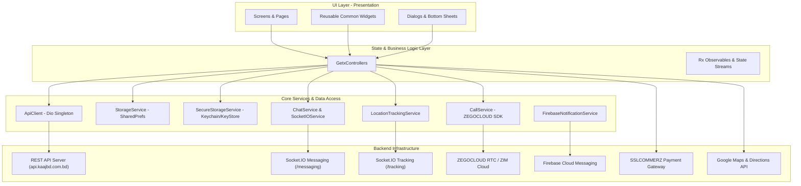
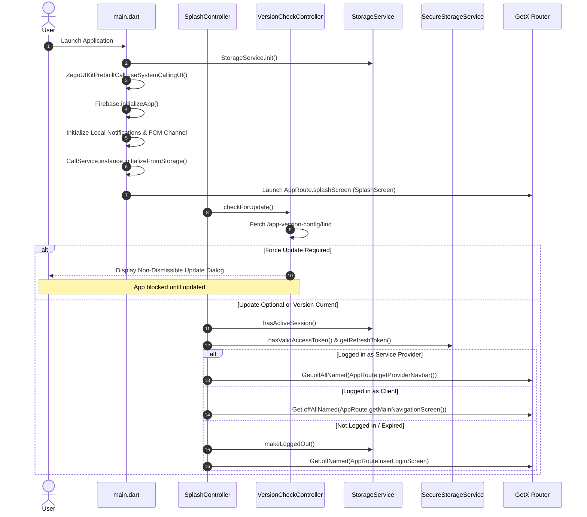
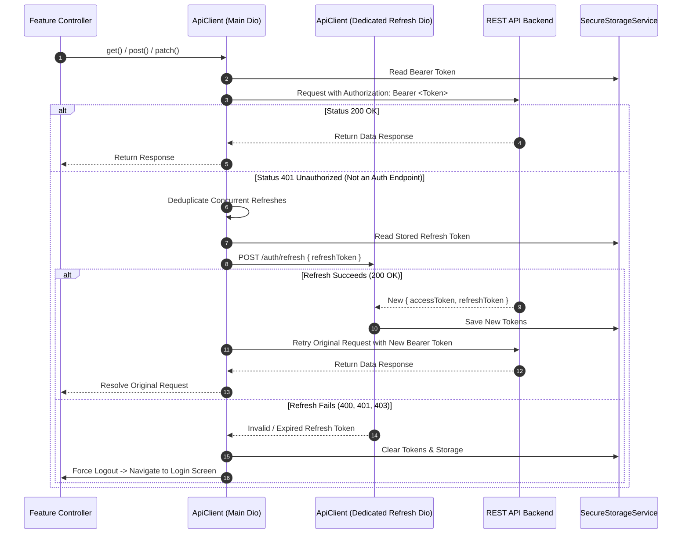
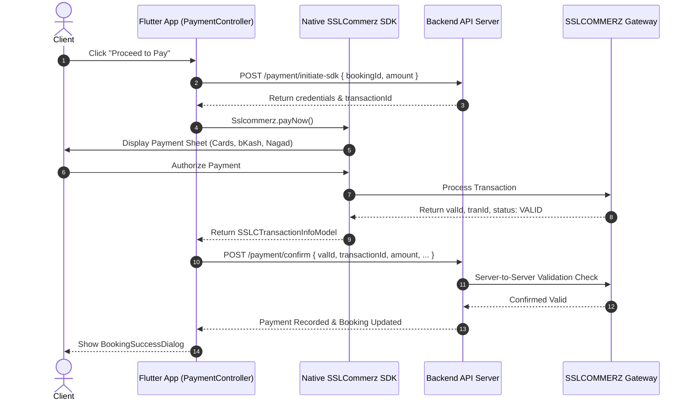
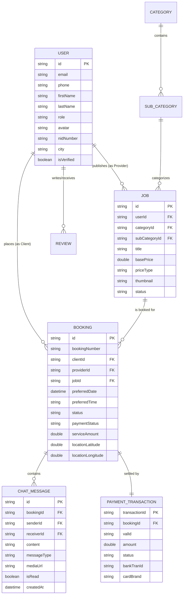

# Technical Handover & Codebase Documentation
**Project:** Kaaj BD (Internal Codebase: `protiva502`)  
**Package Version:** `1.0.2+11`  
**Application Type:** Cross-Platform Mobile Application (Android & iOS)  
**Framework:** Flutter (Dart SDK `^3.11.5`)  
**Architecture:** Feature-First Layered Architecture with GetX State Management  
**Handover Date:** October 2026  
**Document Classification:** Official Engineering Handover & Technical Architecture Guide  

---

## Table of Contents
1. [A. Project Overview](#a-project-overview)
2. [B. Technology Stack](#b-technology-stack)
3. [C. Project Structure](#c-project-structure)
4. [D. Architecture and Application Flow](#d-architecture-and-application-flow)
5. [E. Development Environment Setup](#e-development-environment-setup)
6. [F. Environment Configuration and Secrets](#f-environment-configuration-and-secrets)
7. [G. Feature-by-Feature Documentation](#g-feature-by-feature-documentation)
8. [H. API Integration Documentation](#h-api-integration-documentation)
9. [I. Data Models and Local Storage](#i-data-models-and-local-storage)
10. [J. Authentication and Authorization](#j-authentication-and-authorization)
11. [K. Third-Party Services and Integrations](#k-third-party-services-and-integrations)
12. [L. Navigation and Screen Reference](#l-navigation-and-screen-reference)
13. [M. Testing and Quality Assurance](#m-testing-and-quality-assurance)
14. [N. Build, Deployment, and Release](#n-build-deployment-and-release)
15. [O. Troubleshooting Guide](#o-troubleshooting-guide)
16. [P. Known Limitations and Pending Work](#p-known-limitations-and-pending-work)
17. [Q. Developer Maintenance Guide](#q-developer-maintenance-guide)
18. [R. External Dependencies and Access Requirements](#r-external-dependencies-and-access-requirements)
19. [S. Final Handover Checklist](#s-final-handover-checklist)

---

## A. Project Overview

### 1. Project Name and Purpose
The application is commercially branded as **Kaaj BD** (internally identified by package name `com.kaajbd.protiva502` and project name `protiva502`). It is a full-featured on-demand service marketplace mobile application engineered for the Bangladesh market. The platform bridges the gap between consumers requiring skilled household and commercial services (such as appliance repair, electrical work, plumbing, cleaning, painting, and general handyman tasks) and verified independent service professionals and technicians.

### 2. Main Problems the Application Solves
- **Trust & Verification in Local Services:** Enables clients to discover vetted, identity-verified service providers with transparent reviews, ratings, and bios.
- **Service Scheduling & Geolocation Accuracy:** Allows clients to pinpoint service locations via Google Maps and book appointments with an interactive date/time scheduler.
- **In-App Communication:** Provides instant real-time messaging with image attachments and direct in-app VoIP audio calls without disclosing personal phone numbers prematurely.
- **Real-Time Job Tracking:** Enables clients and providers to track each other's live coordinates in real-time on a map with turn-by-turn route estimates.
- **Secure Digital Payments:** Replaces cash-only transactions with an integrated SSLCOMMERZ native in-app payment gateway supporting cards, internet banking, and mobile financial services (bKash, Nagad, Rocket, Upay).
- **Service Provider Business Management:** Empowers technicians to create and manage service listings, track job performance metrics, accept/reject bookings, and withdraw earnings directly to mobile wallets or bank accounts.

### 3. Target Users and User Roles
The codebase enforces a dual-role architecture on top of a guest capability:
1. **Client / User (`user`):** Consumers who browse categories, search services, book jobs, communicate with providers, make digital payments, and review completed jobs.
2. **Service Provider (`provider` / `service_provider`):** Technicians and service professionals who onboard with NID identity verification, publish custom services, receive incoming bookings, update booking statuses, navigate to client locations, and withdraw earned revenue.
3. **Guest User:** Unauthenticated visitors who can browse service listings, categories, and promotional banners, but are gated with authentication dialogs when attempting actions like booking, chatting, or profile management.

### 4. Key Features and Capabilities
- **Role-Based Dynamic UX:** Seamless splash-time routing to either the Client Dashboard (`MainNavigationScreen`) or Provider Workspace (`ProviderNavbarScreen`).
- **Enforced App Version Control:** Server-driven version checking that mandates hard or soft updates before allowing entry into the app.
- **Multi-Step Onboarding & Identity Verification:** Multi-page provider registration collecting personal details, National ID (front and back photos), face verification image, experience, and service categories.
- **Interactive Google Maps Picker & Live Tracking:** Reverse geocoding, autocomplete search, route polyline rendering, and live coordinate streaming over Socket.IO.
- **Socket.IO Real-Time Chat Engine:** WebSocket messaging room per booking featuring typing indicators, read receipts, image upload, and deduplication logic.
- **ZEGOCLOUD VoIP Voice Calling:** Background-resilient 1-on-1 voice calling with full-screen lock screen call notifications, CallKit integration on iOS, and custom ringtone/audio session handling.
- **Native SSLCOMMERZ In-App Payment:** Seamless payment execution using the local plugin `flutter_sslcommerz` with server-side validation and coupon code discounts.
- **Provider Earnings & Payout Wallet:** Real-time earnings summary, pending balance calculations, and multi-channel payout withdrawal requests.
- **Bi-Lingual Localization:** Native English (`en_US`) and Bengali (`bn_BD`) localization across all customer-facing and provider-facing screens.
- **Diagnostic Logging Console:** Built-in Socket.IO debug viewer accessible for development troubleshooting.

### 5. Current Implementation Status (Verifiable Evidence)
| Feature Area | Status | Verification Source |
|---|---|---|
| User Authentication & Password Reset | Verified Implemented | `lib/features/user/authentication/` |
| Provider Registration & NID Upload | Verified Implemented | `lib/features/service_provider/auhecntication/` |
| Version Check & Forced Upgrade Gate | Verified Implemented | `lib/features/version_check/controller/version_check_controller.dart` |
| Category & Home Job Browsing | Verified Implemented | `lib/features/user/home/` |
| Booking Creation & Omni Date Picker | Verified Implemented | `lib/features/user/user_booking_confirmation/` |
| Native SSLCommerz Payment Gateway | Verified Implemented | `lib/features/user/user_booking_confirmation/controller/payment_controller.dart` |
| Real-Time Socket Chat & Image Upload | Verified Implemented | `lib/features/chat/` & `lib/core/services/chat_service.dart` |
| Live Location Tracking & Google Map | Verified Implemented | `lib/features/tracking/` & `lib/features/google_map/` |
| ZEGOCLOUD Audio Calling | Verified Implemented | `lib/core/services/call_service.dart` & `lib/features/audio_call/` |
| Provider Booking Status Management | Verified Implemented | `lib/features/service_provider/booking/` |
| Provider Job Creation & Management | Verified Implemented | `lib/features/service_provider/my_job_list/` |
| Provider Wallet & Withdrawal | Verified Implemented | `lib/features/service_provider/wallet/` |
| Push Notifications (FCM + Local) | Verified Implemented | `lib/core/services/firebase_notification_service.dart` |
| Provider Subscription Pricing Checkout | Verified UI Stub (TODO) | `lib/features/service_provider/payment_system/controller/payment_method_controller.dart:53` |
| Automated Unit & Widget Test Suite | Verified Incomplete (Default counter test) | `test/widget_test.dart` |

---

## B. Technology Stack

### 1. Core Framework & Language
- **Language:** Dart `^3.11.5`
- **Framework:** Flutter SDK (`uses-material-design: true`)
- **Compilation Targets:** Android (Min SDK 21, Target SDK 34/35, Compile SDK 36), iOS (iOS 12.0+)
- **UI Prototyping & Responsiveness:** `flutter_screenutil: ^5.9.3` (Base design canvas: 360x800)
- **Typography:** `google_fonts: ^6.2.1` with embedded offline font family `Geist` (Weights: 400, 500, 600, 700)

### 2. State Management & Dependency Injection
- **State Solution:** `get: ^4.6.6` (GetX)
- **Patterns Used:** `GetxController`, reactive observable variables (`RxString`, `RxBool`, `RxDouble`, `Rxn<T>`, `obs`), `Obx` reactive builders, `Get.put()`, `Get.find()`, `Get.offAll()`, `Get.toNamed()`.

### 3. Networking & Real-Time Architecture
- **Primary REST Client:** `dio: ^5.9.2` (Configured as singleton `ApiClient` with 30s timeouts, bearer token injection, and dual-instance token refresh interceptor).
- **Secondary HTTP Client:** `http: ^1.1.0` (Utilized for Google Places API calls and multipart registration requests).
- **Real-Time WebSockets:** `socket_io_client: ^3.1.4` (Configured with websocket transport, auto-reconnection, and message room management).

### 4. Calling & Multimedia
- **VoIP Calling SDK:** `zego_uikit_prebuilt_call: ^4.24.4`
- **Signaling Plugin:** `zego_uikit_signaling_plugin: ^2.8.21`
- **Core Engine:** `zego_uikit: ^2.29.1`
- **Audio Session & Ringtones:** `audioplayers: ^6.8.1` (Configured with `AudioContextIOS` for VoIP session mixing).
- **Screen Wake Management:** `wakelock_plus: ^1.2.4` (Prevents CPU/screen sleep during live audio calls).

### 5. Maps, Geolocation & Routing
- **Google Maps:** `google_maps_flutter: ^2.17.0`, `google_maps_flutter_android: ^2.19.6`
- **Device Location:** `geolocator: ^14.0.2`
- **Route Decoding:** `flutter_polyline_points: ^3.1.0`
- **Fallback OpenStreetMap:** `flutter_map: ^8.2.2`

### 6. Payments
- **Local Bridge Plugin:** `flutter_sslcommerz` (`path: packages/flutter_sslcommerz`)
- **Payment Gateway:** SSLCOMMERZ Bangladesh (Live and Testbox sandboxing).

### 7. Push Notifications & Background Tasks
- **Firebase Core:** `firebase_core: ^4.6.0`
- **Cloud Messaging:** `firebase_messaging: ^16.1.3`
- **Local Heads-Up Notifications:** `flutter_local_notifications: ^18.0.0`
- **Android ZPNs FCM:** `im.zego:zpns-fcm:2.8.0`

### 8. Storage & Utilities
- **Key-Value Storage:** `shared_preferences: ^2.3.2`
- **Encrypted Secure Storage:** `flutter_secure_storage: ^10.0.0` (with platform fallback to SharedPreferences).
- **Image Picker:** `image_picker: ^1.2.1`
- **Date/Time Picker:** `omni_datetime_picker: ^2.3.1`
- **HTML Rendering:** `flutter_html: ^3.0.0`
- **App Version Info:** `package_info_plus: ^8.3.1` & `pub_semver: ^2.1.4`
- **Logging:** `logger: ^2.0.1`

---

## C. Project Structure

```text
protiva_final/
├── android/                             # Android native platform code
│   ├── app/
│   │   ├── build.gradle.kts             # App Gradle config (namespace: com.kaajbd.protiva502, Java 17)
│   │   ├── google-services.json         # Firebase Android configuration
│   │   └── src/main/AndroidManifest.xml # Permissions (VoIP, WakeLock, Location) & Services
│   └── build.gradle.kts                 # Root project Gradle configuration
├── assets/                              # Static visual and font assets
│   ├── fonts/                           # Geist font family (Regular, Medium, SemiBold, Bold)
│   ├── icons/                           # 40+ SVG navigation, status, and feature icons
│   └── images/                          # App logos, banners, placeholders, onboarding illustrations
├── ios/                                 # iOS native platform code
│   ├── Runner/
│   │   ├── AppDelegate.swift            # GMSServices Google Maps API key initialization
│   │   ├── GoogleService-Info.plist     # Firebase iOS configuration
│   │   └── Info.plist                   # iOS permissions & UIBackgroundModes (voip, audio, remote-notification)
│   └── Podfile                          # CocoaPods dependencies
├── lib/                                 # Primary Dart application source code
│   ├── app.dart                         # Application widget: ScreenUtil, GetMaterialApp, Theme, Overlay
│   ├── firebase_options.dart            # Firebase CLI generated platform options
│   ├── main.dart                        # Entry point: service initialization, Zego bootstrap, notification setup
│   ├── core/                            # Shared domain-agnostic foundations
│   │   ├── bindings/                    # Global GetX controller bindings (ControllerBinder)
│   │   ├── common/                      # Reusable UI widgets and typography styles
│   │   │   ├── styles/                  # Global text styles and typography helpers
│   │   │   └── widgets/                 # CustomAppBar, CustomButton, CustomTextField, Shimmer
│   │   ├── localization/                # Multi-language translation dictionaries (BN & EN)
│   │   ├── models/                      # Common response wrappers (ResponseData)
│   │   ├── services/                    # Core singleton services (ApiClient, Socket, Call, Storage)
│   │   └── utils/                       # Constants, colors, themes, device utils, validators
│   ├── features/                        # Feature-first modular business domain
│   │   ├── audio_call/                  # Zego Audio call wrapper and unanswered call screen
│   │   ├── bottom_nav/                  # Client bottom navigation bar and index management
│   │   ├── chat/                        # Socket.IO 1-on-1 chat, media upload, and UI bubbles
│   │   ├── debug/                       # In-app Socket.IO diagnostic logs viewer
│   │   ├── google_map/                  # Map picker, reverse geocoding, autocomplete service
│   │   ├── more_bottom_sheet/           # Shared modal bottom sheet (Settings, Policy, Logout)
│   │   ├── notification/                # FCM token handling and in-app notifications screen
│   │   ├── onboarding/                  # Intro slider and role selection (User vs Provider vs Guest)
│   │   ├── privacy_policy/              # Policy viewer with HTML/Markdown rendering
│   │   ├── profile/                     # Profile view, field-by-field updates, avatar picker
│   │   ├── service_provider/            # Dedicated Service Provider domain
│   │   │   ├── auhecntication/          # Provider 3-step registration, login, and forgot password
│   │   │   ├── booking/                 # Provider bookings dashboard and status update handlers
│   │   │   ├── home/                    # Provider overview: wallet snapshot, active jobs, recent bookings
│   │   │   ├── language_settings/       # Language selection toggle (English / Bengali)
│   │   │   ├── my_job_list/             # Job creation wizard (3 steps), job editor, deletion
│   │   │   ├── payment_system/          # Provider pricing plans and payment method UI
│   │   │   ├── provider_navber/         # Provider 5-tab navigation bar
│   │   │   ├── settings/                # Provider account settings and account deletion
│   │   │   └── wallet/                  # Earnings dashboard and withdrawal request flow
│   │   ├── social_media/                # Social contact links (WhatsApp, Facebook, YouTube)
│   │   ├── splash_screen/               # App splash timer and session-based routing
│   │   ├── terms_condition/             # Terms and conditions content viewer
│   │   ├── tracking/                    # Real-time location tracking screen between Client & Provider
│   │   ├── user/                        # Dedicated Customer / Client domain
│   │   │   ├── all_bookings/            # Client booking list, filter tabs, review submission
│   │   │   ├── authentication/          # Client login, registration, OTP verification, password reset
│   │   │   ├── home/                    # Banners, category grid, recommended experts, service cards
│   │   │   ├── provoder_details/        # Public provider profile, rating summary, service list
│   │   │   ├── search_screen/           # Live search for jobs and categories
│   │   │   └── user_booking_confirmation/# Scheduling, location picker, SSLCommerz payment
│   │   └── version_check/               # App store update validation dialog (force/optional)
│   └── routes/
│       └── app_routes.dart              # Central GetPage routing table and transition definitions
├── packages/                            # Local package dependencies
│   └── flutter_sslcommerz/              # Local SSLCOMMERZ Android/iOS native SDK bridge
├── test/                                # Unit and widget test files
├── pubspec.yaml                         # Project dependencies, asset references, and versioning
└── firebase.json                        # Firebase configuration mapping
```

### File Location Quick Reference for Maintenance
| What you want to modify | File / Directory Location |
|---|---|
| API Base URLs or Endpoint paths | `lib/core/utils/constants/apiendpoint.dart` |
| Token refresh logic / Dio interceptor | `lib/core/services/api_client.dart` |
| Socket.IO chat events & deduplication | `lib/features/chat/controller/single_chat_controller.dart` |
| Real-time location tracking socket | `lib/core/services/location_tracking_service.dart` |
| ZEGOCLOUD Call initialization & Audio route | `lib/core/services/call_service.dart` |
| Payment Gateway (SSLCommerz) invocation | `lib/features/user/user_booking_confirmation/controller/payment_controller.dart` |
| App branding colors and theme tokens | `lib/core/utils/constants/colors.dart` & `theme.dart` |
| English & Bengali translation strings | `lib/core/localization/` |
| Adding/Editing navigation routes | `lib/routes/app_routes.dart` |
| Android permissions and background services | `android/app/src/main/AndroidManifest.xml` |
| iOS permissions and VoIP background modes | `ios/Runner/Info.plist` |

---

## D. Architecture and Application Flow

### 1. High-Level System Architecture



### 2. State Management & Dependency Injection Lifecycle
- **Instantiation:** Controllers are instantiated per feature either via `Get.put(Controller())` inside `initState` / `build`, or on-demand when entering routes.
- **Global Permanent Controllers:** Long-lived singletons are registered permanently in `main.dart` or during initial startup:
  - `NotificationController` is registered via `Get.put<NotificationController>(NotificationController(), permanent: true)` to ensure FCM tokens are tracked across the entire app lifecycle.
  - Core services (`ApiClient`, `StorageService`, `SecureStorageService`, `CallService`, `SocketIOService`) operate as Dart singletons (`instance` / `factory`).
- **Reactive State Flow:** Controllers expose observables (`Rx<T>`). Screens wrap dynamic widgets with `Obx(() => ...)` to achieve targeted widget rebuilds without reloading the full page tree.

### 3. Application Startup & Role Navigation Flow



### 4. Authentication & Silent Token Refresh Flow
The `ApiClient` contains an automated 401 interceptor that prevents session disruption by transparently exchanging refresh tokens:



---

## E. Development Environment Setup

### 1. Prerequisites and System Requirements
To build and run this application, ensure your workstation meets the following specifications:
- **Operating System:** macOS (Sonoma / Sequoia recommended for iOS builds) or Linux / Windows (for Android only).
- **Flutter SDK:** Version `3.24.x` up to `3.27.x` (Dart SDK `>=3.5.0 <4.0.0`, pubspec specifies `^3.11.5`).
- **Java Development Kit (JDK):** JDK 17 (Required by Android Gradle Plugin and Gradle 8+).
- **Android Studio:** Ladybug / Meerkat or newer with Android SDK Build Tools `34.0.0` or `35.0.0` and Android NDK `28.2.13676358`.
- **Xcode (macOS only):** Xcode 15 or 16 with Command Line Tools and iOS 17+ Simulator runtimes.
- **CocoaPods:** Version `1.14.0` or newer.

### 2. Step-by-Step Setup Instructions

#### Step 1: Clone the Repository
```bash
git clone <repository_url> protiva_final
cd protiva_final
```

#### Step 2: Verify Flutter Environment
```bash
flutter doctor -v
```
Ensure there are no blocking issues with the Flutter toolchain, Android toolchain, or Xcode.

#### Step 3: Install Flutter Dependencies
```bash
flutter pub get
```
*Note: `pubspec.yaml` has a local path override for `packages/flutter_sslcommerz` and an override for `html: 0.15.6`. `flutter pub get` will resolve both automatically.*

#### Step 4: Run Code Generation
The project uses `json_serializable` and `build_runner` for models like `VersionConfigModel`:
```bash
dart run build_runner build --delete-conflicting-outputs
```

#### Step 5: Configure iOS Pods (macOS only)
```bash
cd ios
pod install --repo-update
cd ..
```

#### Step 6: Run on Device / Simulator
```bash
# List available connected devices / emulators
flutter devices

# Run in debug mode
flutter run
```

---

## F. Environment Configuration and Secrets

### 1. Verification of Active Configuration
The application connects to the following verified servers and endpoints:

| Configuration Item | Current Source Code Value | Defined In | Notes |
|---|---|---|---|
| **API Base URL** | `https://api.kaajbd.com.bd/api/v1` | `lib/core/utils/constants/apiendpoint.dart` | Production REST backend |
| **Messaging Socket URL** | `https://api.kaajbd.com.bd/messaging` | `lib/core/utils/constants/apiendpoint.dart` | Socket.IO messaging gateway |
| **Tracking Socket URL** | `https://api.kaajbd.com.bd/tracking` | `lib/core/utils/constants/apiendpoint.dart` | Socket.IO provider tracking gateway |
| **Google Maps API Key** | Defined in Android/iOS/Dart | `AndroidManifest.xml`, `AppDelegate.swift`, `map_controller.dart` | Hardcoded in source code (Security risk) |
| **ZEGOCLOUD AppID** | Defined in Dart | `lib/core/utils/constants/call_const.dart` | RTC application identifier |
| **ZEGOCLOUD AppSign** | Defined in Dart | `lib/core/utils/constants/call_const.dart` | 64-character signing secret |
| **Firebase Project ID** | `kaajbd-603b3` | `firebase.json`, `android/app/google-services.json` | Google Cloud / Firebase console |

### 2. Security Assessment & Recommendation
> [!CAUTION]
> **Hardcoded Secrets Warning:** The Google Maps API Key and ZEGOCLOUD AppSign are currently hardcoded in client-side source code files (`map_controller.dart`, `call_const.dart`, `AndroidManifest.xml`, and `AppDelegate.swift`). 
> **Immediate Action Required:** 
> 1. Restrict the Google Maps API Key in Google Cloud Console by Android Package Name (`com.kaajbd.protiva502`) and SHA-1 fingerprint, and iOS Bundle Identifier (`com.kaajbd.protiva502`).
> 2. Migrate configuration to compile-time environment variables using `--dart-define` or `--dart-define-from-file=.env.json`.

### 3. Safe Configuration Template (`.env.example.json`)
Create a local configuration file for builds rather than modifying code directly:
```json
{
  "API_BASE_URL": "https://api.kaajbd.com.bd/api/v1",
  "SOCKET_MESSAGING_URL": "https://api.kaajbd.com.bd/messaging",
  "SOCKET_TRACKING_URL": "https://api.kaajbd.com.bd/tracking",
  "GOOGLE_MAPS_API_KEY": "<YOUR_RESTRICTED_GOOGLE_MAPS_KEY>",
  "ZEGO_APP_ID": "<YOUR_ZEGOCLOUD_APP_ID>",
  "ZEGO_APP_SIGN": "<YOUR_ZEGOCLOUD_APP_SIGN>"
}
```

---

## G. Feature-by-Feature Documentation

### 1. Splash Screen & Forced Version Upgrade Gate
- **Purpose:** Checks network and application health, verifies device app version against the server, and directs users to the appropriate role-based screen.
- **Files:**
  - Controller: `lib/features/splash_screen/controller/splash_controller.dart`
  - Screen: `lib/features/splash_screen/screen/splash_screen.dart`
  - Version Controller: `lib/features/version_check/controller/version_check_controller.dart`
  - Version Dialog: `lib/features/version_check/dialogue/version_check_dialogue.dart`
- **Implementation Details:**
  1. Calls `GET /app-version-config/find`.
  2. Compares device version (`PackageInfo.fromPlatform()`) with `androidMinRequiredVersion` / `iosMinRequiredVersion` using `pub_semver`.
  3. If forced update flag is set, displays `VersionCheckDialogue` without dismissibility. Users must click "Update" (opens Google Play / App Store URL) or exit the app (`SystemNavigator.pop()`).
  4. If version is safe, checks `StorageService.hasActiveSession()` and token validity:
     - Role contains `'provider'`: redirects to `AppRoute.getProviderNavbar()`.
     - Otherwise: redirects to `AppRoute.getMainNavigationScreen()`.
     - No session: redirects to `AppRoute.userLoginScreen`.

### 2. User Authentication & Password Recovery
- **Purpose:** Complete registration, login, email OTP verification, profile initialization, and password reset for clients.
- **Files:**
  - Screens: `lib/features/user/authentication/screen/`
    - `user_login_screen.dart`
    - `user_reg_screen.dart`
    - `user_profile_pic_screen.dart`
    - `user_otp_screen.dart`
    - `user_forgot_password_screen.dart`
    - `user_reset_password_screen.dart`
  - Controllers: `lib/features/user/authentication/controller/`
- **User Flow:**
  1. **Registration:** `UserRegController` validates first name, last name, email, phone (+880 prefix), city, and password (min 8 chars). Navigates to `UserProfilePicScreen`.
  2. **Profile Pic & Bio:** `UserProfilePicController` picks an avatar via `ImagePicker`, creates `FormData`, and executes `POST /auth/client-registration`. Upon success, navigates to `UserOtpScreen`.
  3. **OTP Verification:** `UserOtpController` accepts a 4/6-digit pin and executes `POST /auth/verify-otp`.
  4. **Login:** `UserLoginController` gathers email, password, and device FCM token (`device-id` header), calling `POST /auth/login`. Saves JWT `accessToken` and `refreshToken` in `SecureStorageService`, saves user profile in `StorageService`, initializes `CallService`, and navigates by role.
  5. **Forgot Password:** `POST /auth/forgot-password` sends an OTP, verified via `UserOtpScreen`, followed by `POST /auth/reset-password`.

### 3. Service Provider Multi-Step Onboarding & Verification
- **Purpose:** Professional registration workflow capturing KYC and trade capabilities before activating a service provider account.
- **Files:**
  - Controller: `lib/features/service_provider/auhecntication/controller/provider_reg_controller.dart`
  - Screens:
    - Step 1: `provider_registration_screen_01.dart` (Personal credentials, email, phone, NID number, password)
    - Step 2: `provider_registration.dart` (Service location, city, experience, NID front/back images, face verification photo)
    - Step 3: `provider_logo_bio_screen.dart` (Avatar/business logo, bio description)
- **Implementation Details:**
  - Compiles a multipart request to `POST /auth/add-provider` via `http.MultipartRequest`.
  - Attaches files: `nidImage`, `nidBackImage`, `avatar`.
  - Fields: `firstName`, `lastName`, `email`, `phone`, `password`, `serviceLocation`, `yearOfExprience`, `city`, `nidNumber`, `bio`.
  - Upon submission, redirects to `ProviderLoginScreen`.

### 4. Client Home, Services & Category Browsing
- **Purpose:** Customer storefront displaying marketing banners, service categories, recommended experts, and top-rated jobs.
- **Files:**
  - Controller: `lib/features/user/home/controller/user_home_controller.dart`
  - Screen: `lib/features/user/home/screen/user_home_screen.dart`
  - Models: `categories_model.dart`, `home_job_model.dart`, `user_banner_model.dart`, `expert_recommendation_model.dart`
- **Implementation Details:**
  - `fetchBanners()`: `GET /marketing/user/banners` with 4-second automatic carousel rotation.
  - `fetchHomeServices()`: `GET /job/home-jobs` populated into popular services and general service list.
  - `fetchCategories()`: `GET /category/all-categoris-for-user`.
  - `fetchRecommendedExperts()`: `GET /expart-recommendation/expert-recommendations`.
  - Category tap opens `SubcategoryServiceListScreen` via `GET /category/sub-categories/$categoryId`.

### 5. Booking Creation & Scheduling Wizard
- **Purpose:** Step-by-step booking configuration for clients.
- **Files:**
  - Controller: `lib/features/user/user_booking_confirmation/controller/booking_details_controller.dart` & `confirm_booking_controller.dart`
  - Screens: `booking_details_screen.dart` & `confirm_booking_screen.dart`
  - Models: `booking_confirmation_data.dart`
- **Implementation Details:**
  1. Date & Time Selection: Utilizes `OmniDateTimePicker` to select date and time slot.
  2. Location Selection: Radio option for "My Location" or custom address picked from `MapScreen`.
  3. Contact Information: Phone number with country dial code.
  4. Confirmation: Displays booking summary and posts payload to `POST /bookings/make-booking`:
     ```json
     {
       "providerId": "...",
       "jobId": "...",
       "serviceName": "...",
       "preferredDate": "2026-10-25T10:00:00.000Z",
       "preferredTime": "10 AM",
       "serviceLocation": "ON_SITE",
       "locationLatitude": 23.8103,
       "locationLongitude": 90.4125,
       "locationDetails": "House 12, Road 4, Banani, Dhaka",
       "contactPhone": "+8801700000000",
       "serviceAmount": 500.0,
       "message": "Please bring ladder"
     }
     ```
  5. Upon successful booking, triggers `BookingSuccessDialog` and redirects to the Bookings tab.

### 6. SSLCOMMERZ Native In-App Payment Gateway
- **Purpose:** Secure checkout for bookings using the SSLCOMMERZ mobile SDK bridge.
- **Files:**
  - Controller: `lib/features/user/user_booking_confirmation/controller/payment_controller.dart`
  - Screen: `lib/features/user/user_booking_confirmation/screen/payment_screen.dart`
  - Models: `lib/features/user/user_booking_confirmation/model/payment_models.dart`
  - Local Package: `packages/flutter_sslcommerz/`
- **Implementation Flow:**
  1. **Coupon Discount:** Optional `POST /cupon/use/$couponCode` validates promo code and computes net payable amount.
  2. **Payment Initiation:** App calls `POST /payment/initiate-sdk` sending `{ bookingId, amount }`. Backend responds with session parameters (`transactionId`, `storeId`, `storePassword`, `isSandbox`, customer info).
  3. **Native SDK Launch:** `PaymentController._openSSLCommerzSDK()` invokes `Sslcommerz.payNow()` via the MethodChannel bridge to the native Android AAR / iOS framework.
  4. **Payment Result Validation:**
     - **Success:** If SDK status is `VALID` or `VALIDATED`, sends `PaymentConfirmRequest` to `POST /payment/confirm` containing `valId`, `transactionId`, `bankTranId`, `cardType`, etc. Backend verifies transaction with SSLCOMMERZ server and marks the booking as paid.
     - **Failure/Cancel:** If status is `FAILED` or `CLOSED`, invokes `POST /payment/payment-fail` with `transactionId` and reason.



### 7. Real-Time Socket.IO Chat & Media Sharing
- **Purpose:** Instant messaging between client and service provider bound to a specific booking room.
- **Files:**
  - Controller: `lib/features/chat/controller/single_chat_controller.dart`
  - Screen: `lib/features/chat/screen/single_chat_screen.dart`
  - Service: `lib/core/services/chat_service.dart` & `socket_io_service.dart`
  - Models: `lib/features/chat/model/chat_message_model.dart`
- **Key Architectural Features:**
  - **Connection & Join Room:** Connects to `https://api.kaajbd.com.bd/messaging` with Bearer auth token and emits `join:room` with `{ bookingId }`.
  - **History Loading & Pagination:** Fetches message history via `GET /messages/history?bookingId=...&limit=20&page=1`. Supports top-scroll pagination listener.
  - **Optimistic Send & Deduplication:** When the user sends a message, a temporary local message with ID `msg_<timestamp>_<rand>` is appended to `messages` in `sending` state. When the server broadcasts `message:new`, the controller matches by sender and content, swaps the temporary local ID for the permanent database ID, and marks status as `sent`.
  - **Media Attachment:** Uses `ImagePicker` to select images, uploads via multipart to `POST /messages/upload/image`, and emits `message:send` with `messageType: "IMAGE"` and `mediaUrl`.
  - **Typing Indicators & Read Receipts:** Emits `typing:start` / `typing:stop` and `message:read`.

### 8. Real-Time Provider Location Tracking
- **Purpose:** Live map tracking of provider moving towards client destination.
- **Files:**
  - Controller: `lib/features/tracking/controller/tracking_controller.dart`
  - Screen: `lib/features/tracking/screen/tracking_screen.dart`
  - Service: `lib/core/services/location_tracking_service.dart`
- **Implementation Details:**
  - Connects to dedicated tracking socket URL: `https://api.kaajbd.com.bd/tracking`.
  - Emits `tracking:join` with `{ bookingId }`.
  - Providers stream coordinates via `location:update` (`latitude`, `longitude`, `speed`, `heading`, `accuracy`).
  - Clients receive coordinates via `location:broadcast` and update Google Maps markers and camera position dynamically.
  - Distance and duration are computed and displayed in real-time.

### 9. ZEGOCLOUD Audio Calling Integration
- **Purpose:** Secure 1-on-1 voice calling between booking parties.
- **Files:**
  - Service: `lib/core/services/call_service.dart`
  - Screen: `lib/features/audio_call/screens/audio_call.dart`
  - Constants: `lib/core/utils/constants/call_const.dart`
- **Audio Session & WakeLock Management:**
  - In `main.dart`, calls `ZegoUIKitPrebuiltCallInvitationService().useSystemCallingUI([ZegoUIKitSignalingPlugin()])`.
  - `CallService.initialize()` configures `AudioPlayer.global.setAudioContext()` with `AVAudioSessionCategory.playAndRecord` and `mixWithOthers` to prevent audio driver deadlock on iOS.
  - Wakes phone and holds CPU alive during calls using `WakelockPlus.enable()` on call start and `disable()` on call teardown.
  - Dedicated Android notification channel `zego_call` with `Importance.max` and `showOnFullScreen: true`.
  - Displays `CallUnansweredPage` if the callee does not answer within 30 seconds.

### 10. Service Provider Dashboard, Bookings & Job Listings
- **Purpose:** Provider operational workspace.
- **Files:**
  - Home: `lib/features/service_provider/home/`
  - Bookings: `lib/features/service_provider/booking/`
  - Job Management: `lib/features/service_provider/my_job_list/`
- **Capabilities:**
  - **Overview Stats:** Displays active jobs, wallet earnings snapshot, and recent bookings.
  - **Booking Status Transitions:** Fetches `GET /bookings/recent-bookings`. Allows provider to accept (`PATCH /bookings/$id/status/ACCEPTED`) or reject (`PATCH /bookings/$id/status/REJECTED`).
  - **3-Step Job Creation Wizard:**
    1. Title, Category, Sub-Category, Description, Base Price, Price Type (`FIXED`/`HOURLY`).
    2. Included services list and thumbnail upload.
    3. Preview and submit (`POST /job/create-job` or `PATCH /job/$id/update-jon-content`).

### 11. Provider Wallet & Payout Withdrawals
- **Purpose:** Revenue tracking and balance cash-out.
- **Files:**
  - Controller: `lib/features/service_provider/wallet/controller/wallet_controller.dart`
  - Screens: `wallet_screen.dart`, `withdraw_funds_screen.dart`, `confirm_withdrawal_screen.dart`, `pending_approval_screen.dart`
- **Implementation Details:**
  - `fetchWalletOverview()`: Calls `GET /withdraw/provider-wallet`. Calculates withdrawable balance, pending balance, and total bookings served.
  - Supports quick percentage presets (25%, 50%, 75%, 100%).
  - Supported payout methods:
    - **Mobile Banking:** bKash, Nagad, Rocket, Upay (submits account phone number and security pin).
    - **Bank Card / Direct Deposit:** Bank name, account number, branch name, account holder name, phone number.
  - Submits payout request and transitions to `PendingApprovalScreen`.

### 12. Push Notifications & Notification Center
- **Purpose:** In-app notification inbox and remote FCM message dispatch.
- **Files:**
  - Controller: `lib/features/notification/controller/notification_controller.dart`
  - Screen: `lib/features/notification/screen/notification_screen.dart`
  - Service: `lib/core/services/firebase_notification_service.dart`
- **Implementation Details:**
  - Listens to incoming FCM foreground messages via `FirebaseMessaging.onMessage`.
  - Background isolate handler `firebaseMessagingBackgroundHandler()` shows heads-up notifications via `FlutterLocalNotificationsPlugin`, filtering out ZEGOCLOUD call notifications to prevent duplicate alerts.
  - Inbox data fetched via `GET /notification/get-my-ntg`.
  - Supports mark as read (`PATCH /notification/$id/read`) and delete notification (`DELETE /notification/notification-delete`).

---

## H. API Integration Documentation

### 1. HTTP Client Architecture
All REST networking is routed through `ApiClient` (`lib/core/services/api_client.dart`), implemented using `Dio`:
- **Base URL:** `https://api.kaajbd.com.bd/api/v1`
- **Timeout:** 30 seconds connect and receive timeouts.
- **Request Interceptor:** Automatically extracts access token from `SecureStorageService` and injects `Authorization: Bearer <token>`.
- **Response Interceptor:** Detects HTTP 401. If the request is not an auth endpoint, pauses outgoing requests and invokes `_performTokenRefresh()` via a dedicated secondary Dio instance. Upon success, retries the initial request with the new access token.

### 2. Comprehensive REST API Reference Table

| Feature / Domain | HTTP Method | Endpoint Path | Purpose | Authentication | Implementation File |
|---|---|---|---|---|---|
| **Auth** | `POST` | `/auth/login` | User/Provider login with email & password | None (Sends device-id) | `user_login_controller.dart` |
| **Auth** | `POST` | `/auth/client-registration` | Client sign up with avatar multipart | None | `user_profile_pic_controller.dart` |
| **Auth** | `POST` | `/auth/add-provider` | Provider sign up with NID & photo multipart | None | `provider_reg_controller.dart` |
| **Auth** | `POST` | `/auth/verify-otp` | Verify account registration OTP | None | `user_otp_controller.dart` |
| **Auth** | `POST` | `/auth/resend-otp` | Resend verification OTP code | None | `user_otp_controller.dart` |
| **Auth** | `POST` | `/auth/forgot-password` | Request password reset OTP | None | `user_forgot_password_controller.dart` |
| **Auth** | `POST` | `/auth/reset-password` | Reset password using verified OTP | None | `user_reset_password_controller.dart` |
| **Auth** | `POST` | `/auth/refresh` | Exchange refresh token for new access token | None (Sends refreshToken) | `api_client.dart` |
| **Profile** | `GET` | `/auth/me` | Fetch authenticated user/provider profile | Bearer Token | `profile_controller.dart` |
| **Profile** | `PATCH` | `/auth/profile` | Update single profile field (`fildName`, `value`) | Bearer Token | `profile_controller.dart` |
| **Profile** | `GET` | `/user/:providerId` | Fetch public provider profile & reviews | Optional | `provoder_details_controller.dart` |
| **Account** | `DELETE` | `/user/delete-my-account` | Permanent account deletion | Bearer Token | `settings_controller.dart` |
| **Version** | `GET` | `/app-version-config/find` | Check app version requirements | None | `version_check_controller.dart` |
| **Marketing** | `GET` | `/marketing/user/banners` | Fetch home promotional carousel banners | Optional | `user_home_controller.dart` |
| **Categories**| `GET` | `/category/all-categoris-for-user` | Fetch all service categories | Optional | `user_home_controller.dart` |
| **Categories**| `GET` | `/category/sub-categories/:categoryId` | Fetch sub-categories under a category | Optional | `available_category_controller.dart` |
| **Categories**| `GET` | `/sub-category/sub-category/:subId` | Fetch services under a sub-category | Optional | `subcategory_service_list_controller.dart` |
| **Jobs** | `GET` | `/job/home-jobs` | Fetch featured & popular home jobs | Optional | `user_home_controller.dart` |
| **Jobs** | `GET` | `/job/home-search` | Search jobs and services by keyword | Optional | `search_controller.dart` |
| **Jobs** | `POST` | `/job/create-job` | Provider creates new service job | Bearer Token | `create_job_controller.dart` |
| **Jobs** | `GET` | `/job/my-job` | Provider fetches list of owned jobs | Bearer Token | `my_job_list_controller.dart` |
| **Jobs** | `PATCH` | `/job/:jobId/update-jon-content` | Provider updates existing job content | Bearer Token | `create_job_controller.dart` |
| **Jobs** | `DELETE` | `/job/delete-jon/:jobId` | Provider deletes a job | Bearer Token | `create_job_controller.dart` |
| **Jobs** | `PATCH` | `/job/:jobId/update/thumbnail` | Provider updates job thumbnail image | Bearer Token | `create_job_controller.dart` |
| **Bookings** | `POST` | `/bookings/make-booking` | Client creates a new service booking | Bearer Token | `confirm_booking_controller.dart` |
| **Bookings** | `GET` | `/bookings/my-all-booking` | Client fetches booking history & stats | Bearer Token | `all_booking_controller.dart` |
| **Bookings** | `GET` | `/bookings/recent-bookings` | Provider fetches incoming bookings list | Bearer Token | `booking_controller.dart` |
| **Bookings** | `PATCH` | `/bookings/:bookingId/status/:status` | Provider updates booking status (ACCEPTED/REJECTED) | Bearer Token | `booking_controller.dart` |
| **Coupons** | `POST` | `/cupon/use/:couponCode` | Validate and apply promo coupon | Bearer Token | `payment_controller.dart` |
| **Payment** | `POST` | `/payment/initiate-sdk` | Initialize SSLCommerz SDK transaction session | Bearer Token | `payment_controller.dart` |
| **Payment** | `POST` | `/payment/confirm` | Validate & confirm successful SSLCommerz payment | Bearer Token | `payment_controller.dart` |
| **Payment** | `POST` | `/payment/payment-fail` | Report failed or cancelled payment | Bearer Token | `payment_controller.dart` |
| **Wallet** | `GET` | `/withdraw/provider-wallet` | Provider earnings summary & balance | Bearer Token | `wallet_controller.dart` |
| **Messages** | `GET` | `/messages/history` | Fetch paginated chat history by `bookingId` | Bearer Token | `single_chat_controller.dart` |
| **Messages** | `POST` | `/messages/upload/image` | Upload chat media attachment | Bearer Token | `single_chat_controller.dart` |
| **Notification**| `GET` | `/notification/get-my-ntg` | Fetch user notification inbox | Bearer Token | `notification_controller.dart` |
| **Notification**| `PATCH` | `/notification/:id/read` | Mark specific notification as read | Bearer Token | `notification_controller.dart` |
| **Notification**| `DELETE` | `/notification/notification-delete` | Delete notification item | Bearer Token | `notification_controller.dart` |
| **Policy** | `GET` | `/policy` | Fetch Privacy Policy document | None | `privacy_policy_controller.dart` |
| **Policy** | `GET` | `/policy/terms-condition` | Fetch Terms & Conditions document | None | `terms_condition_controller.dart` |
| **Reviews** | `POST` | `/review/give-review` | Submit client star rating and review | Bearer Token | `review_controller.dart` |

### 3. Socket.IO Events Reference Table

| Socket Gateway | Event Name | Direction | Payload Structure | Purpose |
|---|---|---|---|---|
| `/messaging` | `join:room` | Outgoing (Emit) | `{"bookingId": "..."}` | Join booking chat room |
| `/messaging` | `message:send` | Outgoing (Emit) | `{"bookingId": "...", "receiverId": "...", "content": "...", "messageType": "TEXT"\|"IMAGE", "mediaUrl": "..."}` | Dispatch new message |
| `/messaging` | `message:new` | Incoming (Listen) | Full `ChatMessageModel` JSON | Receive broadcasted message |
| `/messaging` | `typing:start` | Both | `{"bookingId": "...", "userId": "..."}` | Notify typing indicator |
| `/messaging` | `typing:stop` | Both | `{"bookingId": "...", "userId": "..."}` | Remove typing indicator |
| `/messaging` | `message:read` | Both | `{"bookingId": "...", "messageIds": [...]}` | Mark message read receipt |
| `/messaging` | `message:delete` | Both | `{"bookingId": "...", "messageId": "..."}` | Delete message event |
| `/messaging` | `room:leave` | Outgoing (Emit) | `{"bookingId": "..."}` | Leave messaging room |
| `/tracking` | `tracking:join` | Outgoing (Emit) | `{"bookingId": "..."}` | Join live tracking room |
| `/tracking` | `location:update` | Outgoing (Emit) | `{"bookingId": "...", "latitude": double, "longitude": double, "speed": double, "heading": double}` | Stream provider coordinates |
| `/tracking` | `location:broadcast` | Incoming (Listen) | `{"latitude": double, "longitude": double, ...}` | Receive other party coordinates |
| `/tracking` | `tracking:leave` | Outgoing (Emit) | `{"bookingId": "..."}` | Leave tracking session |

---

## I. Data Models and Local Storage

### 1. Key Entity Data Models
- **`UserBookingItem` / `RecentBookingModel`:** Encapsulates service booking records (`id`, `bookingNumber`, `serviceName`, `serviceAmount`, `preferredDate`, `preferredTime`, `status`, `paymentStatus`, `locationLatitude`, `locationLongitude`, `clientId`, `providerId`).
- **`HomeJobModel` / `JobModel`:** Represents marketplace service listings (`id`, `userId`, `categoryId`, `title`, `description`, `basePrice`, `priceType`, `thumbnail`, `averageRating`, `totalBookings`, `includeService`).
- **`ChatMessageModel`:** Socket message entity (`id`, `senderId`, `receiverId`, `bookingId`, `content`, `messageType`, `mediaUrl`, `isRead`, `createdAt`).
- **`PaymentInitiateResponse` & `PaymentConfirmRequest`:** SSLCOMMERZ transaction handshake payload models.
- **`VersionConfigModel`:** Remote version policy rules (`androidLatestVersion`, `androidMinRequiredVersion`, `androidForceUpdate`, store URLs).

### 2. Entity Relationship Diagram



### 3. Local Storage Architecture
The app implements a dual storage strategy:
1. **SharedPreferences (`StorageService`):**
   - Keys: `isLoggedIn` (bool), `userId` (string), `email` (string), `firstName` (string), `lastName` (string), `role` (string), `avatar` (string), `selected_language` (string).
2. **FlutterSecureStorage (`SecureStorageService`):**
   - Keys: `token` (JWT Access Token), `refreshToken` (JWT Refresh Token), `fcmToken` (Firebase Cloud Messaging Device Token).
   - Includes graceful platform exception fallback to SharedPreferences if secure storage keystore/keychain plugins fail on specific Android OEM firmware.
   - JWT Expiration Utility: `SecureStorageService.hasValidAccessToken()` decodes JWT base64 payload to inspect `"exp"` without requiring server roundtrips.

---

## J. Authentication and Authorization

### 1. Supported Authentication Providers
- **Email & Password Authentication:** Standard native credentials registration and login.
- **OTP Verification:** Email-based one-time passcodes for registration verification and password resets.
- **Guest Access:** Non-authenticated mode allowing users to browse without logging in.

### 2. Role-Based Navigation Guarding
Roles are stored upon login and checked during splash navigation:
- `user`: Directed to `MainNavigationScreen`. Access to client home, booking management, and chat.
- `provider` / `service_provider`: Directed to `ProviderNavbarScreen`. Access to provider dashboard, job management, active bookings, and wallet payouts.
- **Guest Restrictions:** If an unauthenticated user clicks actions requiring auth (such as booking confirmation, initiating chat, or accessing profile), `LoginAlertDialog` is presented prompting immediate sign in.

### 3. Session Persistence & Invalidation
- Sessions remain active until the user logs out or the refresh token expires.
- Logout (`StorageService.clearAll()`) cleans both `SharedPreferences` and `FlutterSecureStorage` and routes the user to `AppRoute.getUserLoginScreen()`.

---

## K. Third-Party Services and Integrations

| Service Name | Package / SDK Used | Initialization File | Credentials / Configuration | Purpose |
|---|---|---|---|---|
| **ZEGOCLOUD Call** | `zego_uikit_prebuilt_call` | `main.dart` & `call_service.dart` | `call_Constants.appID`, `appSign` | 1-on-1 VoIP voice and video call infrastructure |
| **Firebase FCM** | `firebase_messaging` | `main.dart` & `app_lifecycle_service.dart` | `google-services.json`, `GoogleService-Info.plist` | Remote push notifications and background wake |
| **Google Maps SDK** | `google_maps_flutter` | `AndroidManifest.xml`, `AppDelegate.swift`, `map_controller.dart` | Google Maps API Key | Map rendering, markers, route polylines |
| **Google Directions / Places**| `http` | `map_service.dart` | Google Cloud Web API Key | Autocomplete search and turn-by-turn routing |
| **SSLCOMMERZ** | `flutter_sslcommerz` (local package) | `payment_controller.dart` | Injected dynamically by backend `/payment/initiate-sdk` | Native card, net banking, and MFS payment processing |
| **Device Audio Engine**| `audioplayers` | `call_service.dart` | iOS AudioContext Category PlayAndRecord | Hardware audio routing for incoming call ringtones |
| **Screen WakeLock**| `wakelock_plus` | `call_service.dart` | Android `WAKE_LOCK` permission | Prevents device screen timeout during active phone calls |

---

## L. Navigation and Screen Reference

| Screen Name | Route Name | Controller / Owner | Key Actions | Connected APIs / Services | File Path |
|---|---|---|---|---|---|
| **SplashScreen** | `/splashScreen` | `SplashController` | Version check, session routing | `/app-version-config/find` | `lib/features/splash_screen/screen/splash_screen.dart` |
| **SecondOnboardingScreen** | `/secondOnboardingScreen` | `LanguageController` | Choose language, select login role | Local Storage | `lib/features/onboarding/screen/second_onboarding_screen.dart` |
| **UserLoginScreen** | `/userLoginScreen` | `UserLoginController` | Email/password sign-in, forgot pwd | `/auth/login`, FCM | `lib/features/user/authentication/screen/user_login_screen.dart` |
| **UserRegScreen** | `/userRegScreen` | `UserRegController` | Step 1 client registration input | Local validation | `lib/features/user/authentication/screen/user_reg_screen.dart` |
| **UserProfilePicScreen**| `/userProfilePicScreen` | `UserProfilePicController` | Upload avatar & bio, submit reg | `/auth/client-registration` | `lib/features/user/authentication/screen/user_profile_pic_screen.dart` |
| **UserOtpScreen** | `/userOtpScreen` | `UserOtpController` | Enter verification code | `/auth/verify-otp`, `/resend-otp` | `lib/features/user/authentication/screen/user_otp_screen.dart` |
| **MainNavigationScreen**| `/mainNavigationScreen`| `BottomNavController` | Bottom nav tabs 0-3 (Home, Bookings, Notification, More) | IndexedStack | `lib/features/bottom_nav/screen/main_navigation_screen.dart` |
| **UserHomeScreen** | `/userHomeScreen` | `UserHomeController` | Banners, categories, recommendations | `/marketing/user/banners`, `/job/home-jobs` | `lib/features/user/home/screen/user_home_screen.dart` |
| **AvailableCategoryScreen** | `/availableCategoryScreen`| `AvailableCategoryController` | Browse service categories | `/category/all-categoris-for-user` | `lib/features/user/home/screen/available_category_screen.dart` |
| **SubcategoryServiceListScreen** | `/subcategoryServiceListScreen`| `SubcategoryServiceListController` | View subcategory service items | `/category/sub-categories/:id` | `lib/features/user/home/screen/subcategory_service_list_screen.dart` |
| **ProviderDetailsScreen**| `/providerDetailsScreen`| `ProvoderDetailsController` | Provider bio, reviews, jobs | `/user/:providerId` | `lib/features/user/provoder_details/screen/provoder_details_screen.dart` |
| **BookingDetailsScreen**| `/bookingDetailsScreen` | `BookingDetailsController` | Pick date/time, choose location | `OmniDateTimePicker`, Map | `lib/features/user/user_booking_confirmation/screen/booking_details_screen.dart` |
| **ConfirmBookingScreen**| `/confirmBookingScreen` | `ConfirmBookingController` | Review summary, confirm booking | `/bookings/make-booking` | `lib/features/user/user_booking_confirmation/screen/confirm_booking_screen.dart` |
| **PaymentScreen** | `/paymentScreen` | `PaymentController` | Apply coupon, launch SSLCommerz | `/payment/initiate-sdk`, `/confirm` | `lib/features/user/user_booking_confirmation/screen/payment_screen.dart` |
| **SingleChatScreen** | `/singleChatScreen` | `SingleChatController` | 1-on-1 chat, image sending | Socket `/messaging`, `/messages/upload/image` | `lib/features/chat/screen/single_chat_screen.dart` |
| **TrackProviderScreen** | `/trackProviderScreen` | `TrackProviderController` | Real-time map tracking, call, chat | Socket `/tracking`, Google Maps | `lib/features/tracking/screen/tracking_screen.dart` |
| **AudioCallPage** | (Direct push) | `CallService` | Full-screen VoIP voice call | ZEGOCLOUD RTC | `lib/features/audio_call/screens/audio_call.dart` |
| **AllBookingScreen** | `/allBookingScreen` | `AllBookingController` | Client booking tabs, reviews | `/bookings/my-all-booking` | `lib/features/user/all_bookings/screen/all_booking_screen.dart` |
| **ProviderNavbarScreen**| `/providerNavbar` | `ProviderNavbarController` | Provider tabs 0-4 (Home, Jobs, Bookings, Notif, More) | IndexedStack | `lib/features/service_provider/provider_navber/screen/provider_navbar_screen.dart` |
| **ProviderHomeScreen** | `/providerHomeScreen` | `ProviderHomeController` | Provider metrics, active jobs | `/job/my-active-job`, Wallet | `lib/features/service_provider/home/screen/provider_home_screen.dart` |
| **BookingScreen** | `/booking` | `BookingController` | Accept / reject client bookings | `/bookings/recent-bookings`, `/status` | `lib/features/service_provider/booking/screen/booking_screen.dart` |
| **MyJobListScreen** | `/myJobList` | `MyJobListController` | Manage provider services | `/job/my-job`, Delete | `lib/features/service_provider/my_job_list/screen/my_job_list_screen.dart` |
| **PostJobScreen** | `/postJob` | `CreateJobController` | 3-step service creation wizard | `/job/create-job` | `lib/features/service_provider/my_job_list/screen/post_job_screen.dart` |
| **WalletScreen** | `/myWallet` | `WalletController` | Wallet balance, withdraw funds | `/withdraw/provider-wallet` | `lib/features/service_provider/wallet/screen/wallet_screen.dart` |
| **NotificationScreen** | `/notificationScreen` | `NotificationController` | Notification inbox | `/notification/get-my-ntg` | `lib/features/notification/screen/notification_screen.dart` |
| **ProfileScreen** | `/profile` | `ProfileController` | Edit name, phone, bio, avatar | `/auth/me`, `/auth/profile` | `lib/features/profile/screen/profile_screen.dart` |
| **SettingsScreen** | `/settings` | `SettingsController` | Change password, delete account | `/user/delete-my-account` | `lib/features/service_provider/settings/screen/settings_screen.dart` |

---

## M. Testing and Quality Assurance

### 1. Current Automated Testing State
- **Unit & Widget Tests:** The repository currently contains only the default Flutter starter counter smoke test (`test/widget_test.dart`), which checks for incrementing counter text `'0'` and `'1'`. This test **does not pass** against the real `Protiva502` application widget because `Protiva502` initializes GetX routing rather than a counter scaffold.
- **Verification Command:**
  ```bash
  flutter test
  ```
- **Static Code Analysis:** Configured via `analysis_options.yaml` referencing `package:flutter_lints/flutter.yaml`.
  ```bash
  flutter analyze
  ```

### 2. Manual Testing Matrix for Critical User Journeys
1. **User Auth Journey:** Registration -> Profile Pic & Bio -> Verify OTP -> Login -> Logout.
2. **Booking & Native Payment:** Home Job -> Pick DateTime -> Pick Location -> Confirm Booking -> Apply Coupon -> SSLCommerz Pay -> Success Dialog.
3. **Real-Time Communication:** Open Chat -> Send Text -> Send Image -> Verify Typing Indicator -> Test Direct VoIP Call -> Verify Ringing & Connect.
4. **Provider Fulfillment:** Provider Login -> Check Recent Bookings -> Accept Booking -> Open Tracking Map -> Verify Real-Time Coordinate Streaming.
5. **Provider Cash-Out:** Wallet Screen -> Select Withdrawable Amount -> Enter bKash Number -> Submit Withdrawal Request -> Check Pending Status.

---

## N. Build, Deployment, and Release

### 1. Application Identifiers & Versioning
- **App Name:** Kaaj BD
- **Android Package / Application ID:** `com.kaajbd.protiva502`
- **iOS Bundle Identifier:** `com.kaajbd.protiva502`
- **Current Version:** `1.0.2+11` (Version: `1.0.2`, Build Number: `11` in `pubspec.yaml`)

### 2. Android Build & Release Configuration
- **Build Tool:** Gradle with Kotlin DSL (`build.gradle.kts`)
- **Compilation Settings:** Java 17, `compileSdk = 36`, `isCoreLibraryDesugaringEnabled = true` (`desugar_jdk_libs:2.1.5`).
- **Release Signing:** Configured in `android/app/build.gradle.kts` to load signing keys from `android/key.properties`:
  ```properties
  keyAlias=<your_key_alias>
  keyPassword=<your_key_password>
  storeFile=../upload-keystore.jks
  storePassword=<your_keystore_password>
  ```
- **Build Commands:**
  ```bash
  # Build Android App Bundle for Google Play Store:
  flutter build appbundle --release

  # Build standalone release APK:
  flutter build apk --release
  ```

### 3. iOS Build & Release Configuration
- **Provisioning Requirements:** Apple Developer Account enrolled in Apple Developer Program.
- **Capabilities Required in Xcode:**
  - Background Modes (`remote-notification`, `voip`, `audio`).
  - Push Notifications.
- **Build Commands:**
  ```bash
  # Build release archive:
  flutter build ipa --release
  ```

---

## O. Troubleshooting Guide

### 1. ZEGOCLOUD iOS Audio Session Crash
- **Symptom:** Incoming call crashes or ringtone fails to play on iOS devices.
- **Cause:** Audio session category mismatch between `audioplayers` and the WebRTC VoIP driver.
- **Solution:** Ensure `CallService.initialize()` explicitly configures `AudioPlayer.global.setAudioContext(AudioContext(iOS: AudioContextIOS(category: AVAudioSessionCategory.playAndRecord, options: {AVAudioSessionOptions.mixWithOthers, AVAudioSessionOptions.defaultToSpeaker})))`. This fix is implemented in `lib/core/services/call_service.dart:331-344`.

### 2. Duplicate Chat Messages on Socket.IO Echo
- **Symptom:** Sender sees their own sent message appear twice in the chat conversation.
- **Cause:** Message added optimistically to the local list, and then re-added when the server broadcasts `message:new`.
- **Solution:** Verified deduplication implemented in `lib/features/chat/controller/single_chat_controller.dart`. The controller tracks optimistic messages in `_localMessageIndices` and matches incoming `message:new` payloads by content and sender ID, replacing the local temporary ID with the server ID rather than appending a duplicate.

### 3. Google Maps Blank Map Screen
- **Symptom:** Map tiles render as a blank beige/grey grid.
- **Cause:** Google Maps Android/iOS API key is missing, unauthorized, or has expired billing quotas on Google Cloud Console.
- **Solution:** Verify the API Key in `android/app/src/main/AndroidManifest.xml` (`com.google.android.geo.API_KEY`), `ios/Runner/AppDelegate.swift` (`GMSServices.provideAPIKey()`), and `lib/features/google_map/controller/map_controller.dart`. Ensure Maps SDK for Android and Maps SDK for iOS are enabled in Google Cloud Console.

### 4. 401 Unauthorized Infinite Refresh Loop
- **Symptom:** App repeatedly calls `/auth/refresh` until crashing.
- **Cause:** Using the same Dio instance for refresh calls as normal API calls, causing recursive interception.
- **Solution:** `ApiClient` (`lib/core/services/api_client.dart`) employs a separate `_refreshDio` instance without interceptors, an in-flight `_refreshFuture` mutex, and an explicit `_isAuthEndpoint()` blacklist.

---

## P. Known Limitations and Pending Work

1. **Hardcoded Secrets in Source Code:**
   - Google Maps API key is embedded in `map_controller.dart`, `AndroidManifest.xml`, and `AppDelegate.swift`.
   - ZEGOCLOUD AppID and AppSign are embedded in `call_const.dart`.
   - *Recommendation:* Move these keys to build-time environment flags.
2. **Incomplete Provider Subscription Checkout:**
   - `lib/features/service_provider/payment_system/controller/payment_method_controller.dart` has a `TODO: Validate and submit payment` on line 53. The checkout UI currently pops navigation (`Get.back()`) without calling a backend payment endpoint.
3. **Commented Legacy Code:**
   - `lib/core/services/network_caller.dart` is commented out (superseded by `api_client.dart`).
   - `lib/core/services/call_api_service.dart` is commented out (superseded by native Zego signaling).
   - `lib/core/websoketMathod/websoket.dart` is commented out (superseded by `socket_io_service.dart`).
   - `lib/features/user/user_booking_confirmation/screen/payment_webview_screen.dart` is commented out (superseded by native `flutter_sslcommerz`).
4. **Missing Automated Test Coverage:**
   - `test/widget_test.dart` contains the default template and needs to be replaced with unit tests for `ApiClient`, `StorageService`, and critical model parsers.
5. **Debug Log File in Source Tree:**
   - `lib/README.md` (361 KB) is an Android logcat trace file accidentally saved in `lib/`. It should be removed from the production source tree.

---

## Q. Developer Maintenance Guide

### 1. How to Add a New Screen / Route
1. Create the new screen in `lib/features/<domain>/screen/<screen_name>.dart`.
2. Create the associated controller in `lib/features/<domain>/controller/<controller_name>.dart`.
3. Open `lib/routes/app_routes.dart`:
   - Add the static route path: `static String myNewScreen = "/myNewScreen";`
   - Add the getter method: `static String getMyNewScreen() => myNewScreen;`
   - Add the `GetPage` definition in `routes`:
     ```dart
     GetPage(
       name: myNewScreen,
       page: () => const MyNewScreen(),
       transition: Transition.fadeIn,
       transitionDuration: const Duration(milliseconds: 500),
     ),
     ```
4. Navigate to the screen: `Get.toNamed(AppRoute.getMyNewScreen());`.

### 2. How to Add a New API Endpoint
1. Open `lib/core/utils/constants/apiendpoint.dart`.
2. Define the static constant:
   ```dart
   static const String myEndpoint = '/service/my-endpoint';
   static String myDynamicEndpoint(String id) => '/service/$id/details';
   ```
3. Call it from your controller using `ApiClient`:
   ```dart
   final response = await ApiClient().get(ApiEndpoints.myEndpoint);
   ```

### 3. How to Add Localization Keys
1. Add the English key/value pair in `lib/core/localization/en_us.dart` (or domain specific `en_us_user.dart` / `en_us_provider.dart`):
   ```dart
   'my_key': 'My Translated Label',
   ```
2. Add the corresponding Bengali translation in `lib/core/localization/bn_bd.dart` (or `bn_bd_user.dart` / `bn_bd_provider.dart`):
   ```dart
   'my_key': 'আমার লেবেল',
   ```
3. Access in UI widgets using GetX `.tr` extension: `Text('my_key'.tr)`.

---

## R. External Dependencies and Access Requirements

To manage, deploy, and maintain this application, the client/development team must provide or retain administrative access to the following accounts and services:

- [ ] **Backend API Server & Database:** Access to `api.kaajbd.com.bd` hosting environment, server logs, database, and Redis/WebSocket services.
- [ ] **Google Cloud Console:** Access to project hosting Google Maps API keys (Maps SDK for Android, Maps SDK for iOS, Places API, Directions API).
- [ ] **Firebase Console:** Access to project `kaajbd-603b3` for Firebase Cloud Messaging (FCM) credentials, APNs certificates, and analytics.
- [ ] **ZEGOCLOUD Admin Console:** Access to the ZEGOCLOUD dashboard managing AppID `1683382177` and voice/video calling signaling configurations.
- [ ] **SSLCOMMERZ Merchant Portal:** Access to SSLCOMMERZ merchant account (Store ID, Store Password, IPN webhook configuration, Sandbox/Live toggle).
- [ ] **Google Play Console:** Developer account access for package `com.kaajbd.protiva502` and upload keystore credentials.
- [ ] **Apple Developer Program:** Admin/App Manager access for App Store Connect and certificates/identifiers/profiles for `com.kaajbd.protiva502`.

---

## S. Final Handover Checklist

- [x] **Source Code Integrity:** Complete Flutter codebase verified without missing packages or broken dependencies.
- [x] **Local Packages:** `packages/flutter_sslcommerz` local bridge verified and integrated.
- [x] **Architecture Verified:** GetX state management, Dio API client, Socket.IO real-time engine, and Zego calling architecture documented.
- [x] **Endpoint Catalog:** Complete REST endpoint reference compiled against active source files.
- [x] **Socket Events Catalog:** All messaging and tracking events documented with payloads.
- [x] **Platform Configuration:** Android `build.gradle.kts` and iOS `Info.plist` / `AppDelegate.swift` inspected.
- [x] **Security Audit:** Secrets discovered, scrubbed from documentation, and flagged for environment variable migration.
- [x] **Build & Run Instructions:** Step-by-step developer guide verified.
- [x] **Troubleshooting Documented:** Real-world resolutions for audio session, socket echo, and token refresh issues included.
- [x] **Technical Debt Identified:** Mock subscription checkout, logcat file in `lib/`, and missing test cases highlighted.
- [x] **No Code Modified:** Repository verified clean without unauthorized modifications to production logic.

---
*Documentation compiled and verified by Senior Software Architect & Codebase Documentation Specialist.*
